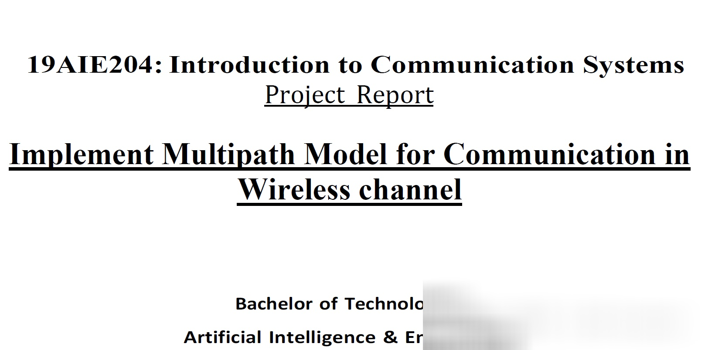
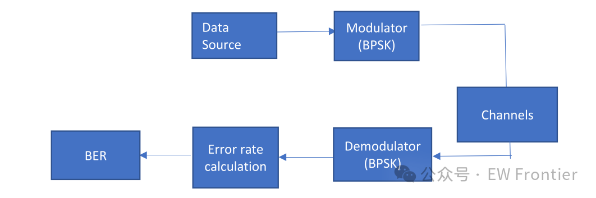
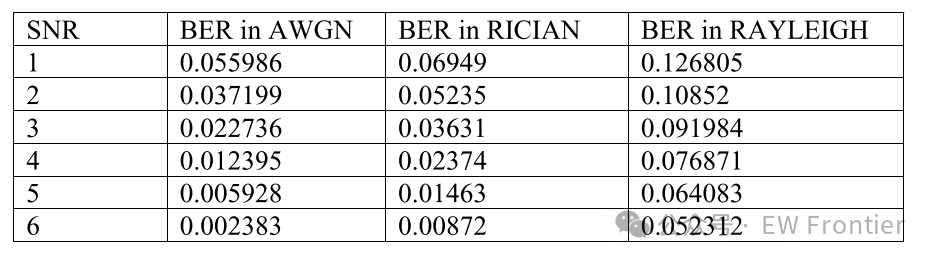
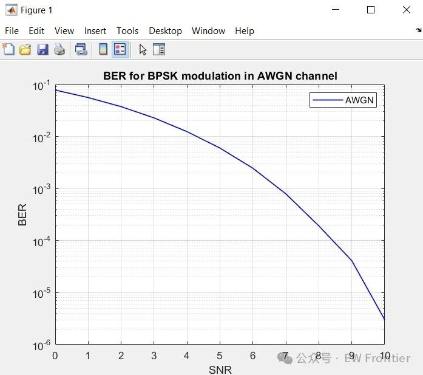
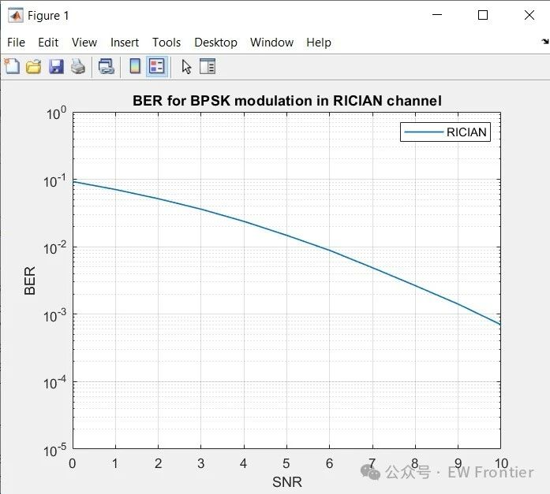
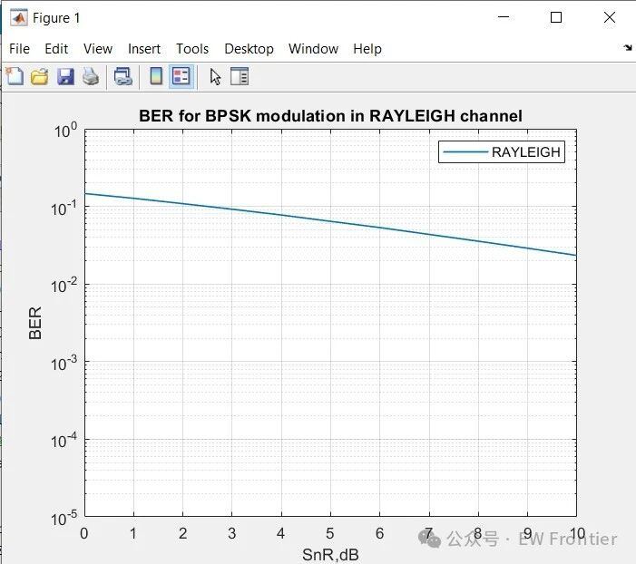

# BPSK error rate implementation in MATLAB under multipath channels (AWGN/RICIAN/Rayleigh)

The task involves implementing the bit error rate (BER) for various multipath models such as AWGN, Rayleigh, and Rician fading channels under BPSK modulation schemes.

Introduction: The wireless industry has developed and deployed infrastructures to provide many services for users. The design, production, and deployment of this technology infrastructure are costly, hence manufacturers seek alternative solutions to avoid high costs. One such alternative is to simulate real wireless systems. The advantage of simulation is that it can reduce the cost of design testing.

One major characteristic of wireless channels is the effect of multipath fading. Multipath refers to the phenomenon where radio signals arrive at a receiving antenna through two or more paths. Fading refers to the distortion experienced by the carrier-modulated telecommunication signal on certain propagation media. In wireless systems, fading is caused by multipath propagation and is sometimes referred to as multipath fading. There are two types of fading effects that characterize mobile communication: large scale fading and small scale fading.

· Large scale fading represents the average signal power decay or path loss due to large-scale movement over large areas. This phenomenon is influenced by prominent topographic features (mountains, forests, billboards, buildings, etc.). Between the transmitter and receiver.

· Small scale fading, also known as Rayleigh fading, describes the envelope of the received signal statistically by the Rayleigh distribution when there are a large number of multiple reflection paths without any line-of-sight component. When there is a dominant non-fading signal component, such as line-of-sight paths, the envelope of the small scale fading signal is described by the Rice distribution.

The selected fading channel should ideally have no errors or be close to error-free. If the signal is error-free, then high-quality voice and data transmission can be achieved. As applications evolve, the choice of fading model becomes a primary concern. Here, the analysis of fading channels is based on the BPSK modulation scheme.

There are three main basic fading channel models:

· Non-line-of-sight (Rayleigh) fading channel model.

· Line-of-sight (Rician) fading channel model.

· Additive white Gaussian noise (AWGN)
The fading is considered to be caused by multipath reception. Rayleigh fading is a reasonable model when there are many objects scattering the radio signal before it reaches the receiver. Rielian fading is most applicable when there is no major line-of-sight propagation between the transmitter and receiver.
Rician fading channel
Rician fading is similar to Rayleigh fading, except that Rician fading has a strong dominant component. This dominant component is a fixed (non-fading) signal, and is usually referred to as the Line of Sight (LOS) component.
AWGN fading channel
Additive white Gaussian noise (AWGN) is commonly used in signal transmission to simulate the background noise of a communication channel. It is a fundamental communication channel model and serves as a standard channel model. The AWGN channel is represented as:
where s(t) is the transmitted signal and n(t) is the white Gaussian noise.
Modulation is defined as the process of superimposing a low-frequency signal on a high-frequency carrier signal. Modulation is the process of encoding information from a message source in a way suitable for transmission. This is achieved by altering the characteristics of the wave. Then, the receiver recovers the original signal through a process called demodulation.
Expected modulation techniques have three positive characteristics:
·Good bit error rate performance
·Power efficiency
·Spectral efficiency
Various types of modulation schemes are involved in communication systems, such as phase shift keying (PSK), frequency shift keying (FSK), minimum frequency shift keying (MSK), quadrature phase shift keying (QPSK), quadrature amplitude modulation (QAM), and binary phase shift keying (BPSK).
Binary Phase Shift Keying (BPSK) is a two-level modulation scheme where the binary message consists of 0 and 1, represented by two different phase states in the carrier signal: 0° for binary 1 and 180° for binary 0. In digital modulation techniques, a set of basis functions are selected for a specific modulation scheme. Typically, these basis functions are orthogonal to each other. Basis functions can be derived using the Gram-Schmidt orthogonalization process. Once the basis functions are chosen, any vector in the signal space can be represented as their linear combination. In BPSK, only one sine wave is used as the basis function. The modulation is achieved by altering the phase of the sine curve according to the bit positions.
Bit Error Rate (BER)
The bit error rate or quality of a digital link is calculated by dividing the number of erroneous bits received by the total number of bits transmitted.
In digital transmission, the number of bit errors is due to changes in the data stream on the communication channel due to noise, interference, distortion, or bit synchronization errors. BER is the number of bit errors divided by the total number of transmitted bits over a specific time interval. BER is a performance metric with no unit and is typically expressed as a percentage.
Signal-to-Noise Ratio (SNR)
The Signal-to-Noise Ratio (SNR) is the ratio of the received signal strength to the noise intensity within the operational frequency range. SNR and BER are inversely related; thus, high BER leads to low SNR. Due to high BER, packet loss, delay, and throughput are affected. The Signal-to-Noise Ratio (SNR) is commonly used as an indicator of the quality of a communication link, measured in decibels and expressed as follows:
The higher the SNR, the easier it is to identify, isolate, and eliminate noise sources. SNR equals zero means that the expected signal and undesired noise are almost indistinguishable.
Block Diagram and Explanation
The above block diagram illustrates the basic digital communication model. The figure describes the basic digital communication model, including transmitter-related modules (data source and modulator). The system model's data source creates a random bit stream, represented as 0s and 1s. In the modulator block, BPSK modulation is used to randomly encode the bits. The modulated signal is then passed to the channel block to propagate an appropriate channel, introducing Gaussian noise, Rician or Rayleigh fading channels into the modulated signal. In the receiver, the demodulator module reverses the operation and extracts the binary signal. It generates a series of random binary bits, which are estimates of the transmitted data.
In this section, we use Matlab to demonstrate and evaluate the results. We assess and analyze the performance of BPSK under AWGN, Rician, and Rayleigh fading channels using the Signal-to-Noise Power Ratio (SNR) (𝐸𝑏/𝑁0) and Bit Error Rate (BER).
The Bit Error Rate (BER) of BPSK in an AWGN Channel
The BER of BPSK in a Rician Channel
The BER of BPSK in a Rayleigh Channel
From the graph, we can see that the AWGN channel has a lower BER than different fading channels. The Rayleigh fading channel has a higher BER than both the Rician and AWGN fading channels. The BER of the Rician fading channel lies between the AWGN channel and the Rayleigh channel.
MATLAB Code for BPSK Bit Error Rate in AWGN Channels % Wireless Channel Comparison using Fading Channels (BPSK Modulation) \n% Computing BER for BPSK modulation in an AWGN channel\nclear; close all; clc; tic; \nn=10^6; % numBER of samples or bits \nbits=randn(1,n)>0.5; %  enerating 0,1 with equal probability\nsignal=2*bits-1; % BPSK modulation 0 -> -1; 1 -> 1     \nnoise=1/sqrt(2)*(randn(1,n)+1i*randn(1,n)); %generating noise with zero mean and var. equal to 1.\nmean(abs(noise.^2)) %test the power of the noise \nSNR=0:10; %set SNR in dB\nsnr_lin=10.^(SNR/10); %calculate linear snr from dB SNR.\ny=zeros(length(SNR),n); \n %multiply sqrt of snr to signal and add noise:\nfor i=1:length(SNR)\n    y(i,:)=real(sqrt(snr_lin(i))*signal+noise); \nend\n%reciever and BER count\nerr=zeros(length(SNR),n); Err=zeros(10,2); \nfor i=1:length(SNR)\n    for j=1:n\n       if y(i,j)>=0\n           y(i,j)=1; \n       else\n           y(i,j)=0; \n       end \n    end\n      err(i,:)=abs(y(i,:)-bits); \n      Err(i,:)=size(find(err(i,:))); \nend\n %calculating BER\nBER=zeros(length(SNR),1); \nfor i=1:length(SNR)\n    BER(i)=Err(i,2)/n; \nend\nsemilogy(SNR,BER,'b-','linewidth',1); grid on; hold on; \nxlabel('SNR'); ylabel('BER'); legend('AWGN') ; toc; \ntitle('BER for BPSK modulation in AWGN channel'); Conclusion: From the simulation results, the bit error rate of digital communication system is an important quality factor for quantifying the integrity of data transmitted through the system. The criterion is the variation of bit error rate under different signal-to-noise ratios. It is observed that the bit error rate is the smallest for AWGN and the largest for Rayleigh. In this project, we have implemented the bit error rate (BER) for multipath models such as AWGN, Rayleigh and Rician fading channels under BPSK modulation scheme.

## Images

<!-- PAYMENT_BLOCK -->

## Get this dataset

- Payment link (Stripe): [Buy now](https://buy.stripe.com/3cs8yP7sY87d0vu9AB)
- Payment QR code: 

<!-- /PAYMENT_BLOCK -->
